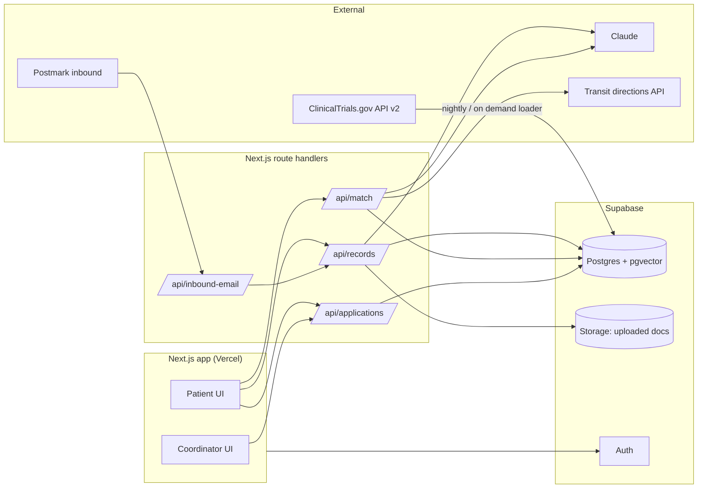
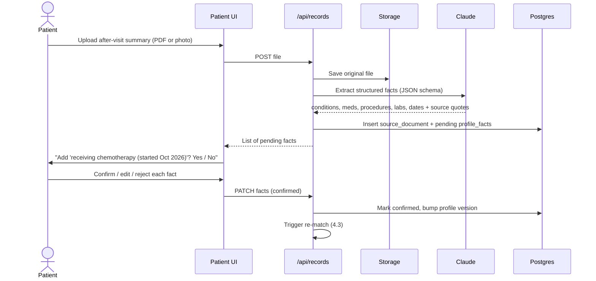
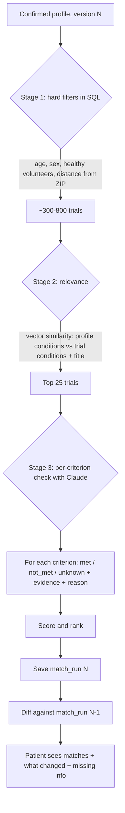
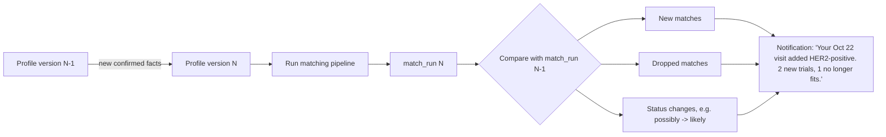
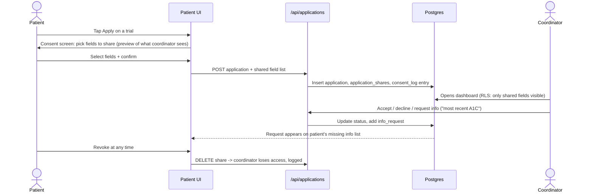
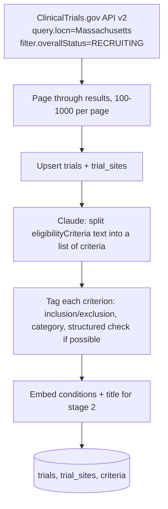
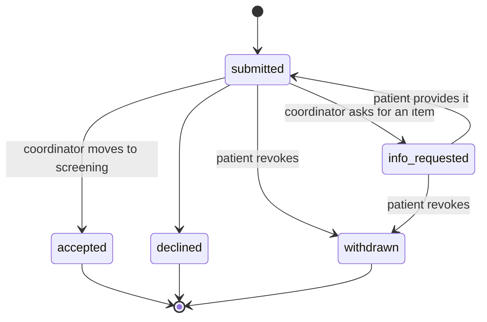
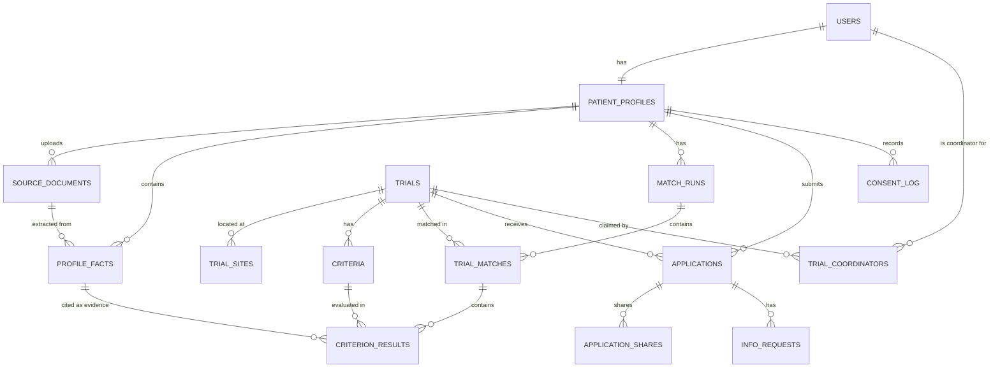

# TrialPass: project spec

Working name. Hackachusetts 2026, Healthcare track, subtrack H5 (Making clinical research more accessible).

## 1. What it does

A patient builds a health profile from their visit records once. TrialPass checks that profile against every recruiting clinical trial in Massachusetts and shows which trials they qualify for, criterion by criterion. Every time a new visit record is added, it re-checks and shows what changed. The patient can apply in one tap and share only the fields they choose. The study coordinator gets a pre-screened, interested patient.

Two users:

- **Patient**: builds the profile, sees matches, fills in missing info, applies.
- **Study coordinator**: claims a trial, reviews interested patients, accepts or asks for more info.

Clinical decisions stay with the study team. TrialPass only pre-screens.

## 2. Scope

| In the demo | Stretch | Roadmap slide only |
|---|---|---|
| Upload after-visit summary (PDF/photo) and extract profile | Forwarded email via inbound address | Wearable data (Whoop, Oura) |
| Patient confirms each extracted item | Epic FHIR sandbox sync | Paid remote data studies |
| Load MA recruiting trials from ClinicalTrials.gov | Haitian Creole, Chinese | Clinician referral mode |
| Criterion checklist: met / not met / unknown | Remote-visit detection | |
| Re-match on new record + "what changed" | | |
| Missing info to-do list | | |
| Plain-language summary (English + Spanish, Portuguese) | | |
| Transit time from ZIP to site | | |
| Consent-based apply, revocable | | |
| Coordinator dashboard | | |
| Accuracy numbers on TrialGPT cohorts | | |

Not building: selling user data.

## 3. Architecture



## 4. Workflows

### 4.1 Adding a visit record



Forwarded email follows the same path: Postmark posts the email to `/api/inbound-email`, the handler finds the user by their inbox address, and each attachment and the email body go through the same extraction step.

### 4.2 Matching pipeline

3,145 Massachusetts trials were recruiting when we checked (Oct 24, 2026). Running Claude on every criterion of every trial for every patient is too slow, so matching runs in stages.



Trial criteria are parsed once, when the trial is loaded, not per patient (see 4.5). Stage 3 results are cached per `(profile_version, trial_id)`.

**Scoring**

```
any exclusion criterion = met       -> status "not eligible"
any inclusion criterion = not_met   -> status "not eligible"
otherwise:
  score = inclusion_met / inclusion_total
  status = "likely eligible" if unknown_count == 0
           "possibly eligible" if unknown_count > 0
rank by: status, then score, then fewer unknowns, then distance
```

### 4.3 Re-matching after a new record



Each change links to the exact criterion and the fact that caused it.

### 4.4 Applying and consent



Before the patient applies, a coordinator sees only a count: "3 interested patients meet 8 of 9 criteria." No names, no contact info.

### 4.5 Loading trials



For the demo, load all ~3,100 trials but only parse criteria for the conditions you'll show (for example oncology, type 2 diabetes, PTSD) if time is short.

### 4.6 Application status



## 5. Data model

### 5.1 Entity diagram



### 5.2 Postgres schema (Supabase)

```sql
create extension if not exists vector;

-- Patients ---------------------------------------------------------------

create table patient_profiles (
  id              uuid primary key default gen_random_uuid(),
  user_id         uuid not null unique references auth.users(id),
  display_name    text,
  birth_year      int,
  sex             text check (sex in ('female','male','other','unknown')),
  zip             text,
  preferred_lang  text default 'en',       -- en, es, pt, ht, zh
  inbox_address   text unique,             -- e.g. u_8f3k2@in.trialpass.app
  version         int not null default 0,  -- bumped on every confirmed change
  created_at      timestamptz default now()
);

create table source_documents (
  id            uuid primary key default gen_random_uuid(),
  profile_id    uuid not null references patient_profiles(id) on delete cascade,
  kind          text check (kind in ('upload','email','manual','fhir')),
  storage_path  text,                      -- Supabase Storage key
  visit_date    date,
  facility      text,
  raw_text      text,                      -- OCR / parsed text
  created_at    timestamptz default now()
);

create table profile_facts (
  id             uuid primary key default gen_random_uuid(),
  profile_id     uuid not null references patient_profiles(id) on delete cascade,
  document_id    uuid references source_documents(id) on delete set null,
  category       text check (category in
                   ('condition','medication','procedure','lab','vital','allergy','demographic','other')),
  label          text not null,            -- "Type 2 diabetes", "Metformin 500mg"
  code_system    text,                     -- ICD-10, RxNorm, LOINC, CPT (optional)
  code           text,
  value_num      numeric,                  -- labs/vitals: 7.9
  value_unit     text,                     -- "%"
  status         text,                     -- active, resolved, ongoing, stopped
  observed_at    date,
  source_quote   text,                     -- exact line from the document
  confirmation   text not null default 'pending'
                   check (confirmation in ('pending','confirmed','rejected')),
  created_at     timestamptz default now()
);

-- Trials -----------------------------------------------------------------

create table trials (
  nct_id              text primary key,    -- NCT05663151
  title               text not null,
  brief_summary       text,
  conditions          text[],
  phase               text,
  overall_status      text,
  sex                 text,                -- ALL, FEMALE, MALE
  min_age_years       numeric,
  max_age_years       numeric,
  healthy_volunteers  boolean,
  eligibility_raw     text,                -- original criteria text, always shown
  summary_plain       jsonb,               -- {"en": "...", "es": "..."}
  stipend_note        text,
  embedding           vector(1024),
  last_synced_at      timestamptz
);

create table trial_sites (
  id         uuid primary key default gen_random_uuid(),
  nct_id     text not null references trials(nct_id) on delete cascade,
  facility   text,
  city       text,
  state      text,
  zip        text,
  lat        double precision,
  lon        double precision,
  contact_name   text,
  contact_email  text,
  contact_phone  text
);

create table criteria (
  id            uuid primary key default gen_random_uuid(),
  nct_id        text not null references trials(nct_id) on delete cascade,
  kind          text not null check (kind in ('inclusion','exclusion')),
  position      int not null,
  text          text not null,             -- original wording
  category      text,                      -- diagnosis, lab, medication, treatment_history, demographic, other
  structured    jsonb                      -- optional machine check, see 5.3
);

-- Matching ---------------------------------------------------------------

create table match_runs (
  id               uuid primary key default gen_random_uuid(),
  profile_id       uuid not null references patient_profiles(id) on delete cascade,
  profile_version  int not null,
  created_at       timestamptz default now(),
  unique (profile_id, profile_version)
);

create table trial_matches (
  id              uuid primary key default gen_random_uuid(),
  run_id          uuid not null references match_runs(id) on delete cascade,
  nct_id          text not null references trials(nct_id),
  status          text check (status in ('likely','possibly','not_eligible')),
  score           numeric,                 -- inclusion_met / inclusion_total
  unknown_count   int,
  nearest_site_id uuid references trial_sites(id),
  transit_minutes int
);

create table criterion_results (
  id            uuid primary key default gen_random_uuid(),
  match_id      uuid not null references trial_matches(id) on delete cascade,
  criterion_id  uuid not null references criteria(id),
  result        text not null check (result in ('met','not_met','unknown')),
  reason        text,                      -- one sentence, plain language
  evidence_fact_ids uuid[],                -- profile_facts used
  missing_item  text                       -- for unknown: "Most recent A1C"
);

-- Applications and consent -----------------------------------------------

create table trial_coordinators (
  user_id  uuid references auth.users(id),
  nct_id   text references trials(nct_id),
  primary key (user_id, nct_id)
);

create table applications (
  id          uuid primary key default gen_random_uuid(),
  profile_id  uuid not null references patient_profiles(id) on delete cascade,
  nct_id      text not null references trials(nct_id),
  match_id    uuid references trial_matches(id),
  status      text not null default 'submitted'
                check (status in ('submitted','info_requested','accepted','declined','withdrawn')),
  created_at  timestamptz default now(),
  unique (profile_id, nct_id)
);

create table application_shares (
  application_id  uuid references applications(id) on delete cascade,
  field           text not null,           -- 'name','email','phone','age','zip', or 'fact:<uuid>'
  revoked_at      timestamptz,
  primary key (application_id, field)
);

create table info_requests (
  id              uuid primary key default gen_random_uuid(),
  application_id  uuid references applications(id) on delete cascade,
  item            text not null,           -- "Most recent A1C"
  fulfilled_fact_id uuid references profile_facts(id),
  created_at      timestamptz default now()
);

create table consent_log (
  id          bigint generated always as identity primary key,
  profile_id  uuid references patient_profiles(id) on delete cascade,
  action      text not null,               -- share, revoke, apply, withdraw
  detail      jsonb,
  created_at  timestamptz default now()
);
```

**Row-level security rules (summary)**

- Patients can read and write only rows tied to their own `patient_profiles.user_id`.
- Coordinators can read `applications` only for trials in `trial_coordinators`, and can read a patient's data only through `application_shares` rows where `revoked_at is null`.
- Coordinators see aggregate counts of interested patients through a view that returns counts only, with no profile columns.
- `trials`, `trial_sites`, `criteria` are public read.

### 5.3 JSON shapes

**Extraction output (Claude, per document)**

```json
{
  "visit_date": "2026-10-22",
  "facility": "Dana-Farber Cancer Institute",
  "facts": [
    {
      "category": "condition",
      "label": "Breast cancer, HER2-positive",
      "code_system": "ICD-10",
      "code": "C50.911",
      "status": "active",
      "observed_at": "2026-10-22",
      "source_quote": "Dx: invasive ductal carcinoma, right breast, HER2+"
    },
    {
      "category": "procedure",
      "label": "Chemotherapy infusion (cycle 2)",
      "status": "ongoing",
      "observed_at": "2026-10-22",
      "source_quote": "Cycle 2 of TCHP administered without complication"
    },
    {
      "category": "lab",
      "label": "Hemoglobin",
      "code_system": "LOINC",
      "code": "718-7",
      "value_num": 11.2,
      "value_unit": "g/dL",
      "observed_at": "2026-10-22",
      "source_quote": "Hgb 11.2"
    }
  ]
}
```

Rule for the prompt: every fact must have a `source_quote` copied from the document. Facts without one are dropped.

**Parsed criterion (stored at trial load)**

```json
{
  "kind": "inclusion",
  "position": 3,
  "text": "HbA1c between 7.0% and 10.5% at screening",
  "category": "lab",
  "structured": {
    "type": "lab_range",
    "loinc": "4548-4",
    "min": 7.0,
    "max": 10.5,
    "unit": "%",
    "max_age_days": 90
  }
}
```

`structured` is optional. When present, the check runs in code. When absent, Claude decides.

**Criterion check (Claude, per trial, stage 3)**

Input: the confirmed profile facts (with ids) and the trial's criteria list.

```json
{
  "nct_id": "NCT0XXXXXXX",
  "results": [
    {
      "criterion_id": "c1",
      "result": "met",
      "reason": "Your record shows HER2-positive breast cancer.",
      "evidence_fact_ids": ["f12"]
    },
    {
      "criterion_id": "c4",
      "result": "unknown",
      "reason": "The trial needs an LVEF of 50% or higher. Your records don't include a heart ultrasound.",
      "evidence_fact_ids": [],
      "missing_item": "Most recent echocardiogram (LVEF)"
    },
    {
      "criterion_id": "e2",
      "result": "not_met",
      "reason": "You have no record of prior anti-HER2 therapy, so this exclusion doesn't apply.",
      "evidence_fact_ids": []
    }
  ]
}
```

For exclusion criteria, `met` means the exclusion applies and the patient is out. The UI should translate this to plain words ("This rules you out" / "Doesn't apply to you") so patients don't read "met" as good.

**Match diff (computed, sent to UI)**

```json
{
  "from_version": 4,
  "to_version": 5,
  "trigger_document": { "id": "d9", "visit_date": "2026-10-22", "facility": "Dana-Farber" },
  "new_facts": ["Breast cancer, HER2-positive", "Chemotherapy infusion (cycle 2)"],
  "added":   [{ "nct_id": "NCT0AAAAAAA", "status": "possibly", "because": ["c1 met by f12"] }],
  "removed": [{ "nct_id": "NCT0BBBBBBB", "because": ["e3: prior chemotherapy within 12 months"] }],
  "changed": [{ "nct_id": "NCT0CCCCCCC", "from": "possibly", "to": "likely" }]
}
```

### 5.4 TypeScript types

```ts
export type CriterionResult = "met" | "not_met" | "unknown";
export type MatchStatus = "likely" | "possibly" | "not_eligible";

export interface ProfileFact {
  id: string;
  category: "condition" | "medication" | "procedure" | "lab" | "vital" | "allergy" | "demographic" | "other";
  label: string;
  codeSystem?: "ICD-10" | "RxNorm" | "LOINC" | "CPT";
  code?: string;
  valueNum?: number;
  valueUnit?: string;
  status?: string;
  observedAt?: string;
  sourceQuote: string;
  confirmation: "pending" | "confirmed" | "rejected";
  documentId?: string;
}

export interface Criterion {
  id: string;
  nctId: string;
  kind: "inclusion" | "exclusion";
  position: number;
  text: string;
  category?: string;
  structured?: Record<string, unknown>;
}

export interface CriterionCheck {
  criterionId: string;
  result: CriterionResult;
  reason: string;
  evidenceFactIds: string[];
  missingItem?: string;
}

export interface TrialMatch {
  nctId: string;
  title: string;
  status: MatchStatus;
  score: number;
  unknownCount: number;
  checks: CriterionCheck[];
  nearestSite?: { facility: string; city: string; transitMinutes?: number };
  summaryPlain?: Record<string, string>;
}

export interface MatchDiff {
  fromVersion: number;
  toVersion: number;
  added: { nctId: string; status: MatchStatus; because: string[] }[];
  removed: { nctId: string; because: string[] }[];
  changed: { nctId: string; from: MatchStatus; to: MatchStatus }[];
}
```

## 6. API routes

| Method | Route | Who | Does |
|---|---|---|---|
| POST | `/api/records` | patient | Upload file, extract facts, return pending facts |
| PATCH | `/api/facts/:id` | patient | Confirm / edit / reject a fact, bumps profile version |
| POST | `/api/inbound-email` | Postmark webhook | Route email to user by inbox address, extract facts |
| POST | `/api/match` | patient | Run pipeline for current profile version (cached) |
| GET | `/api/matches` | patient | Latest match run + diff from previous |
| GET | `/api/missing-info` | patient | Unknown criteria grouped by missing item |
| GET | `/api/trials/:nctId` | anyone | Trial detail, sites, criteria, plain summary |
| POST | `/api/applications` | patient | Apply with selected share fields |
| DELETE | `/api/applications/:id/shares/:field` | patient | Revoke one shared field |
| GET | `/api/coordinator/trials` | coordinator | Claimed trials + interested counts |
| GET | `/api/coordinator/applications?nct=` | coordinator | Applicants with shared fields + checklist |
| PATCH | `/api/coordinator/applications/:id` | coordinator | Accept / decline / request info |
| POST | `/api/admin/sync-trials` | admin | Load trials from ClinicalTrials.gov, parse criteria |

## 7. Screens

**Patient: matches**

```
+--------------------------------------------------------------+
| TrialPass                          [ES] [Upload record]  (A) |
+--------------------------------------------------------------+
| New since your Oct 22 visit at Dana-Farber:                  |
|   + 2 new trials   - 1 no longer fits   [See what changed]   |
+--------------------------------------------------------------+
| Missing info (3)                                             |
|   [ ] Most recent echocardiogram (LVEF)  -> answers 2 trials |
|   [ ] Most recent A1C                    -> answers 1 trial  |
+--------------------------------------------------------------+
| LIKELY ELIGIBLE                                              |
|  HER2+ breast cancer, new antibody combo     9/9 met         |
|  Dana-Farber, Boston  - 35 min transit  - $50/visit   [View] |
|                                                              |
| POSSIBLY ELIGIBLE                                            |
|  Exercise during chemotherapy               6/7 met, 1 ?     |
|  MGH, Boston  - 40 min transit                        [View] |
+--------------------------------------------------------------+
```

**Patient: trial detail**

```
+--------------------------------------------------------------+
| < Back     HER2+ breast cancer, new antibody combo           |
| NCT0XXXXXXX - Phase 2 - Dana-Farber                          |
+--------------------------------------------------------------+
| In plain words (Español | English)                           |
|  This study tests whether adding drug X to standard ...      |
+--------------------------------------------------------------+
| Who can join                                                 |
|  [ok]  HER2-positive breast cancer   <- your Oct 22 visit    |
|  [ok]  Age 18 or older                                       |
|  [?]   Heart function (LVEF) 50%+    -> add echocardiogram   |
| Who can't join                                               |
|  [ok]  Doesn't apply: prior anti-HER2 therapy                |
|                                                              |
|  [Show original trial text]                                  |
+--------------------------------------------------------------+
| Getting there: 35 min by transit - 6 visits - $50 per visit  |
|                                                [ Apply ]     |
+--------------------------------------------------------------+
```

**Patient: consent before applying**

```
+--------------------------------------------------------------+
| Share with Dana-Farber study team                            |
|  [x] First name and email                                    |
|  [ ] Phone                                                   |
|  [x] Age, ZIP                                                |
|  [x] Breast cancer, HER2-positive (Oct 22)                   |
|  [x] Chemotherapy, cycle 2 (Oct 22)                          |
|  [ ] Hemoglobin 11.2 (Oct 22)                                |
|                                                              |
|  They will see: [preview]                                    |
|  You can stop sharing at any time.                           |
|                                   [Cancel]  [Send application]|
+--------------------------------------------------------------+
```

**Coordinator: applicants**

```
+--------------------------------------------------------------+
| NCT0XXXXXXX  HER2+ breast cancer, new antibody combo         |
| Interested but not applied: 3    Applied: 2                  |
+--------------------------------------------------------------+
| Applicant      Criteria   Unknown   Status        Action     |
| Maria, 52      9/9        0         submitted     [Review]   |
| J., 61         8/9        1 (LVEF)  info_requested            |
+--------------------------------------------------------------+
| Review: Maria, 52, ZIP 01841                                 |
|  [ok] HER2+  [ok] Age  [ok] LVEF 58% (added Oct 24)          |
|  [Accept to screening] [Decline] [Request item: ______ ]     |
+--------------------------------------------------------------+
```

## 8. Folder structure

```
trialpass/
  app/
    (patient)/
      page.tsx                 # matches + missing info
      records/page.tsx         # upload + confirm facts
      trials/[nctId]/page.tsx  # detail + apply
    (coordinator)/
      coordinator/page.tsx
      coordinator/[nctId]/page.tsx
    api/
      records/route.ts
      facts/[id]/route.ts
      inbound-email/route.ts
      match/route.ts
      matches/route.ts
      missing-info/route.ts
      applications/route.ts
      coordinator/...
      admin/sync-trials/route.ts
  lib/
    ctgov.ts                   # ClinicalTrials.gov client
    extract.ts                 # document -> facts (Claude)
    criteria.ts                # parse eligibility text -> criteria (Claude)
    match/
      filter.ts                # stage 1 SQL
      relevance.ts             # stage 2 vectors
      check.ts                 # stage 3 Claude per-criterion
      score.ts
      diff.ts
    transit.ts
    supabase.ts
  eval/
    run_trialgpt_eval.py       # accuracy on TrialGPT cohorts
  supabase/
    migrations/0001_init.sql   # schema from section 5.2
  seed/
    synthea/                   # synthetic patients for demo
    demo_documents/            # fake after-visit summaries
```

## 9. External APIs

**ClinicalTrials.gov API v2** (no key needed)

```
GET https://clinicaltrials.gov/api/v2/studies
    ?query.locn=Massachusetts
    &filter.overallStatus=RECRUITING
    &pageSize=1000
    &pageToken=<from previous response>
    &countTotal=true
```

Fields used (confirmed in a live response on Oct 24, 2026):

| Field | Path |
|---|---|
| NCT id | `protocolSection.identificationModule.nctId` |
| Title | `protocolSection.identificationModule.briefTitle` |
| Conditions | `protocolSection.conditionsModule.conditions` |
| Criteria text | `protocolSection.eligibilityModule.eligibilityCriteria` |
| Sex / ages | `eligibilityModule.sex`, `minimumAge`, `maximumAge` ("18 Years") |
| Healthy volunteers | `eligibilityModule.healthyVolunteers` |
| Sites | `protocolSection.contactsLocationsModule.locations[]` with `facility`, `city`, `state`, `geoPoint.lat/lon` |

Notes: criteria text comes as one string with "Inclusion Criteria:" and "Exclusion Criteria:" headings and numbered or bulleted lines, and some symbols are escaped (`\>`). Filter out sites outside Massachusetts after loading, since multi-site trials list every location.

**Claude**: document extraction (vision for photos), criterion parsing, criterion checks, plain-language summaries and translation. Use structured output with the JSON shapes in 5.3.

**Postmark inbound**: forwards emails to `/api/inbound-email` as JSON with attachments.

**Transit**: any directions API with transit mode, cached per `(zip, site_id)`.

## 10. Accuracy measurement

- Use the public patient cohorts and relevance labels released with TrialGPT (NIH/NLM; SIGIR 2016, TREC Clinical Trials 2021 and 2022). Check the repo for the exact files and label format before writing the script.
- Run our stage 2 + stage 3 pipeline on those patients against their trial sets.
- Report precision at 10 and the share of eligible trials ranked in the top 10, next to the numbers in the TrialGPT paper.
- One slide, one table. Note honestly where we're worse.

## 11. Demo data

- Never use real patient records.
- Make 2-3 synthetic patients (Synthea or hand-written), each with 2-3 fake after-visit summaries as PDFs.
- Pick trials for the demo ahead of time and make sure the patient's second document actually changes their matches.

## 12. Demo script (3 minutes)

1. Patient profile with 4 matches. One line on the problem: recruitment stalls trials, and patients can't tell what they qualify for.
2. Upload a new after-visit summary from an oncology infusion. Confirm "receiving chemotherapy."
3. Matches change: 2 new, 1 dropped, each with the reason.
4. Open a trial: checklist in Spanish, original text toggle, 35 min transit, stipend.
5. Missing info: "Add your most recent echocardiogram."
6. Apply, choose 5 fields, see the preview.
7. Coordinator view: applicant with checklist. Request the echo. It appears on the patient's list.
8. Accuracy slide. Privacy slide (what coordinators can and can't see). Roadmap slide.

## 13. Team split

| Person | Owns |
|---|---|
| A | `lib/ctgov.ts`, `lib/criteria.ts`, `lib/match/*`, `eval/` |
| B | `lib/extract.ts`, records upload + confirm screen, inbound email |
| C | Patient pages: matches, diff banner, trial detail, missing info, apply |
| D | Coordinator pages, applications + shares + RLS, demo data, slides |

## 14. Build order

1. Schema migration. Trial loader. Criteria parser on ~200 trials in the demo conditions.
2. Matcher stages 1-3 on one hand-written profile. Check results by reading them. Fix prompts until they look right.
3. Document extraction and confirm screen. Wire confirmed facts into the matcher.
4. Patient UI, match diff, missing info, apply with consent.
5. Coordinator dashboard and info requests.
6. Translations, transit times, plain summaries.
7. Accuracy script and numbers.
8. Demo data, slides, rehearse three times.

Cut first if behind: transit, languages beyond Spanish, inbound email, coordinator info requests.

## 15. Risks

| Risk | Mitigation |
|---|---|
| Claude marks a criterion "met" wrongly | Require evidence fact ids; no evidence means "unknown". Show original text. |
| Extraction invents facts | Require `source_quote`; patient confirms each fact. |
| Too slow to check many trials | Stages 1-2 cut to 25 trials; cache per profile version; run checks in parallel. |
| Judges ask about HIPAA / privacy | Patient-owned data, share-by-field, revocable, logged, coordinators see counts only before apply. |
| Rewritten summaries change study meaning | Always show the original trial text; mark summaries as unofficial. |
| Rules or trial data change | Nightly re-sync from ClinicalTrials.gov; `last_synced_at` shown on trial page. |
